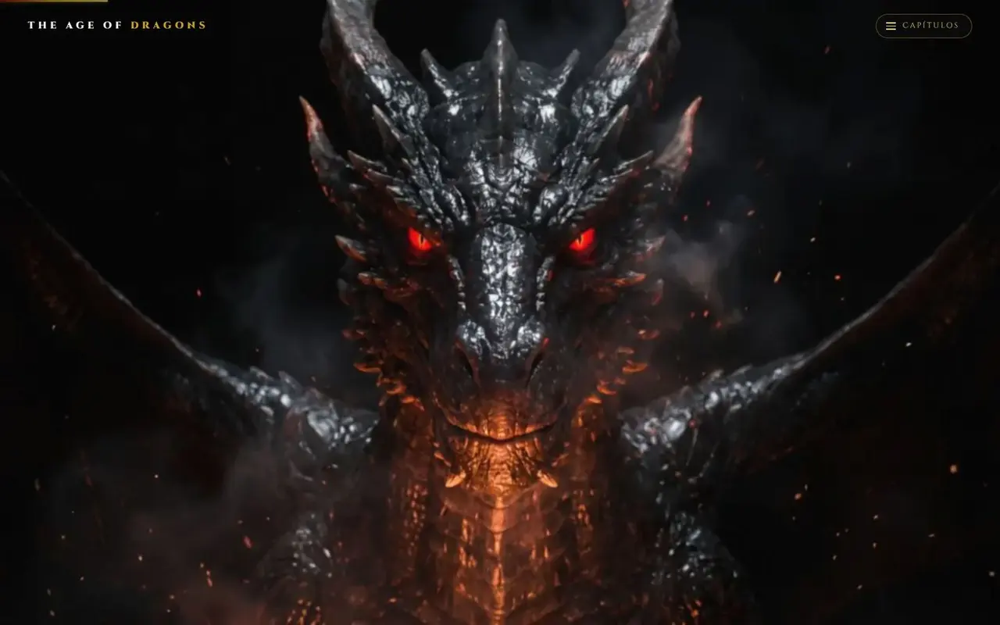
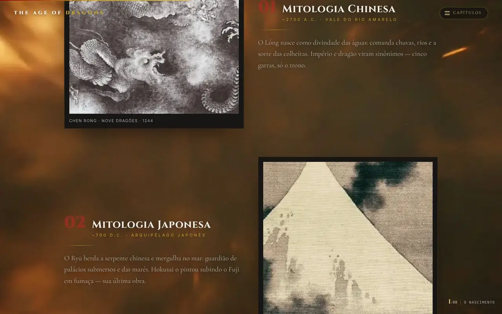

# The Age of Dragons

[English](README.md) · Português

Um "documentário" interativo, conduzido pela rolagem, sobre dragões na mitologia e na cultura pop. Um ato em WebGL abre a página (um dragão revelado no escuro, que avança e sopra fogo conforme você rola), seguido de capítulos sobre as mitologias de dragões pelo mundo, um mapa de onde as lendas nasceram e uma linha do tempo dos dragões nas telas. O conteúdo do site é em português.

> **Tipo:** experiência-conceito fan-made da MilWeb — não oficial e **sem afiliação, endosso ou patrocínio** dos detentores de qualquer franquia citada (ex.: O Hobbit / Tolkien Estate, Game of Thrones / House of the Dragon, How to Train Your Dragon, The Elder Scrolls: Skyrim, Dungeons & Dragons, Dragon Ball, Monster Hunter, Minecraft, Eragon). Os personagens são citados apenas por texto; todas as marcas pertencem aos seus respectivos donos.
>
> **Demo:** https://age-of-dragons.vercel.app





## Funcionalidades

- **Ato I (controlado pela rolagem):** sequências de quadros (`public/dragao/{revelacao,avanco,fogo}`) desenhadas num único canvas WebGL, com variante de 640px para telas pequenas e um cartaz mínimo embutido exibido antes do JavaScript carregar.
- **Fundo procedural de brasa/lava** renderizado com React Three Fiber e pós-processamento, no mesmo canvas do Ato I.
- **Rolagem suave** com Lenis guiado pelo ticker do GSAP; o estado da rolagem chega ao Three.js sem re-render do React (`src/scene/scroll-store.ts`).
- **Capítulo I – "O nascimento":** tradições de dragões (chinesa, japonesa, europeia medieval, bíblica, nórdica, mesoamericana e celta) ilustradas com obras históricas.
- **Capítulo II – "O mapa":** mapa-múndi interativo com marcadores de cada tradição.
- **Capítulo III – "As telas":** linha do tempo dos dragões no cinema e na TV.
- Navegação e indicador de progresso por capítulo, chamada para compartilhar, metadados de SEO, imagem Open Graph, `robots.txt`, `sitemap.xml` e manifesto web.
- Conteúdo extra pesquisado (dragões da ficção, tabela comparativa, curiosidades, galeria) mantido em `src/data/` e `src/components/sections/` para uma futura página de acervo; não é renderizado na home.
- `/laboratorio`: bancada de teste isolada do Ato I com HUD de depuração (`noindex`).

## Stack

- [Next.js](https://nextjs.org) 16.3 (App Router, saída estática) · React 19.2 · TypeScript 5
- Tailwind CSS 4
- Three.js, @react-three/fiber, @react-three/drei, @react-three/postprocessing
- GSAP (+ @gsap/react), Lenis, Framer Motion
- ESLint 9 (`eslint-config-next`)
- Gerenciador de pacotes: pnpm (`pnpm-lock.yaml`)

## Como rodar

Pré-requisitos: Node.js 20.9+ (o CI usa Node 22) e pnpm 10.

```bash
pnpm install --frozen-lockfile
pnpm dev          # http://localhost:3000
```

Nenhuma variável de ambiente é necessária.

## Scripts

| Script | Descrição |
| --- | --- |
| `pnpm dev` | Inicia o servidor de desenvolvimento |
| `pnpm build` | Build de produção |
| `pnpm start` | Serve o build de produção |
| `pnpm lint` | Executa o ESLint |

## Estrutura

```
src/
  app/          # layout, home, /laboratorio, robots, sitemap, manifest
  scene/        # palco WebGL, Ato I, revelação por quadros, fundo ambiente, scroll store
  motion/       # rolagem suave (Lenis) e efeitos guiados pela rolagem
  components/   # navegação e placas de capítulo, seções, ícones
  data/         # conteúdo dos capítulos (eras, mapa, cinema, dados do acervo)
public/
  art/          # obras históricas e arte conceitual usadas nos capítulos
  dragao/       # sequências de quadros do Ato I (+ variantes /sm) e placas de capítulo
  og.jpg        # cartão social
```

## Mídias e créditos

- **Sequências de quadros do Ato I, placas de capítulo e cartão social** foram geradas por IA pelo autor (Higgsfield), conforme o histórico de commits do projeto.
- **Obras históricas** em `public/art/` (creditadas na página): Chen Rong, *Nove Dragões* (1244); Hokusai, *Dragão sobre o Fuji* (1849); Paolo Uccello, *São Jorge e o Dragão* (c. 1470); Albrecht Dürer, *Apocalipse* (1498); Gustave Doré, *A Destruição do Leviatã* (1865); pedra de Ramsund (réplica); Codex Telleriano-Remensis; manuscrito medieval dos dragões de Vortigern. As obras estão em domínio público; a fonte exata de cada reprodução digital não está documentada.
- **Arte conceitual** `dragao-biblia.webp` e `devorador.webp` são imagens geradas por IA fornecidas pelo autor.
- Uma versão anterior usava um vídeo no topo (`public/video/dragao-scrub.mp4`), removido do código atual; sua origem não está documentada.
- Fontes: Cinzel, Cormorant Garamond e Inter via `next/font/google`.

## Limitações

- A experiência depende de WebGL e de cerca de 16 MB de imagens (sequências de quadros); é mais pesada em aparelhos modestos e conexões lentas.
- O conteúdo está disponível apenas em português.
- Não há testes automatizados; as verificações são lint, checagem de tipos e build.

## Segurança

Veja [SECURITY.md](SECURITY.md).

## Licença

Ainda não há licença definida; todos os direitos reservados ao autor. Personagens e marcas de terceiros citados pertencem aos seus respectivos donos.
